# DailyAPP 1.1 — personal use

## Downloads

- **Android:** [Download APK 1.1](https://github.com/NyxPjct/DailyAPP/releases/download/personal-v1.1.0-r3/DailyAPP-1.1-pessoal.apk) — open the file on your phone to install it. Requires Android 7 or later.
- **iPhone:** [Download unsigned IPA 1.1](https://github.com/NyxPjct/DailyAPP/releases/download/personal-v1.1.0-r3/DailyAPP-1.1-sem-assinatura.ipa) — requires iOS 15.4 or later and personal signing before installation. On Windows, follow the [AltServer/AltStore instructions (Portuguese)](docs/CELULAR.md#iphone-sem-mac-pessoal). Opening the IPA alone will not install it.
- **Computer:** [Download the index.html preview](https://github.com/NyxPjct/DailyAPP/releases/download/personal-v1.1.0-r3/DailyAPP-index.zip) — extract the ZIP and open `index.html` in Chrome or Edge.

[Open the Release with the files and SHA-256 hashes](https://github.com/NyxPjct/DailyAPP/releases/tag/personal-v1.1.0-r3). All three files were downloaded and checked after publication.

If DailyAPP is already installed on your Android phone, export a backup from Settings and install the new APK without uninstalling the app. [Check the APK's SHA-256 hash](downloads/DailyAPP-1.1-pessoal.apk.sha256).

**1.1 update:** this revision keeps version 1.1.0, now with build 6, and adds real currency conversion across transactions, budgets, cards, goals, forecasts, and charts. The [guide to each feature](#what-each-feature-does) and [language settings](#languages) are below.

A multilingual app for tasks, scheduling, and personal finances. English is the default, with Portuguese, Spanish, French, and German available in Settings. Its React interface is packaged with Capacitor into apps installed on your phone. Screens, fonts, and icons are included in the installation; local operation does not require hosting, Netlify, or Supabase.

The Android and iPhone packages are available in the Release above. The IPA was built with Xcode 26.3 on a GitHub Actions Mac runner and does not include personal Apple signing. See the [mobile installation and build guide (Portuguese)](docs/CELULAR.md).

To open the mobile interface directly on a computer, generate `artifacts/index.html` with `npm run preview:computer`. This file includes scripts, styles, icons, and fonts: download it and open it in Chrome or Edge. The computer opening the file does not need a server or development tools. Preview records stay in the browser; use backups to transfer them to the app.

## App screenshots

Updated screenshots of **version 1.1, build 6**, showing the English interface and the new currency conversion settings.

| Today in USD | Finances in USD | Currency settings |
| --- | --- | --- |
| 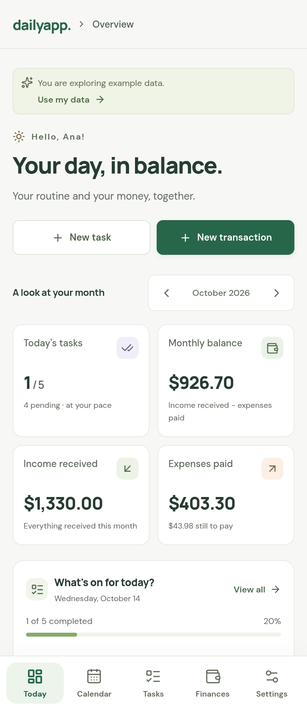 | 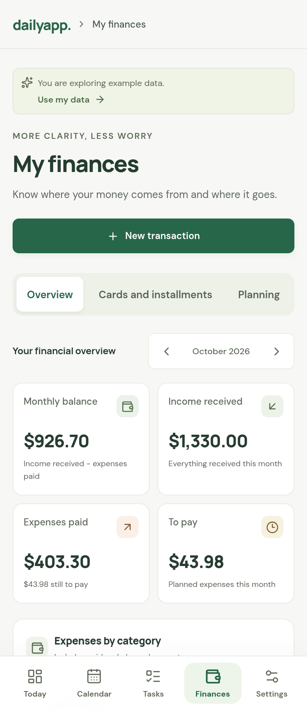 | 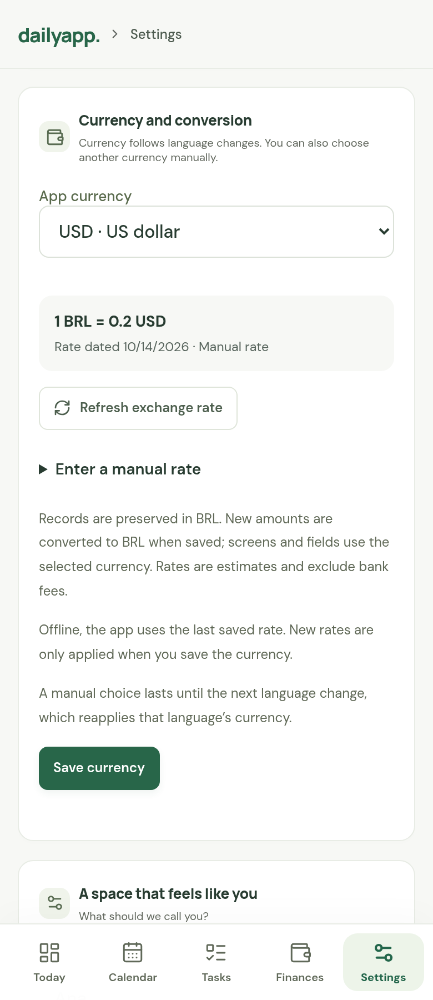 |

These examples use fictional data and an explicitly labeled manual rate of **0.20 USD per BRL**. The app defaults to BRL; the language and currency can be chosen separately.

English interface with the default BRL currency:

| Today | Tasks | Finances |
| --- | --- | --- |
| 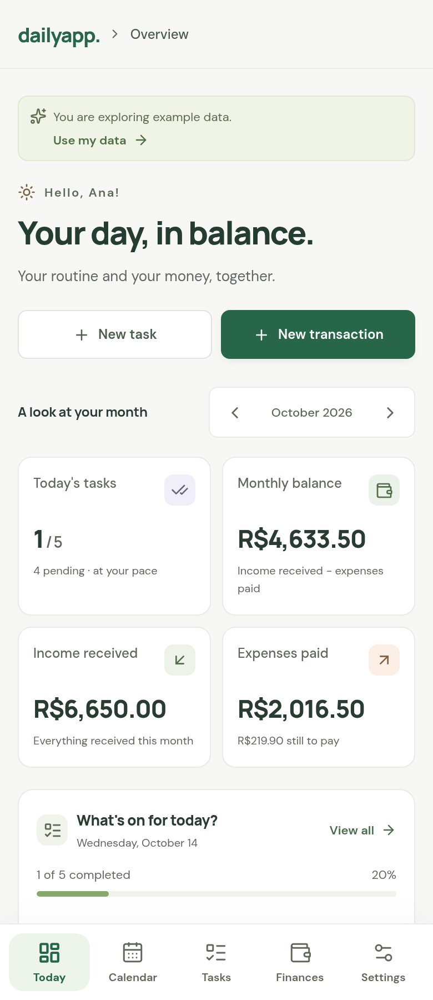 | 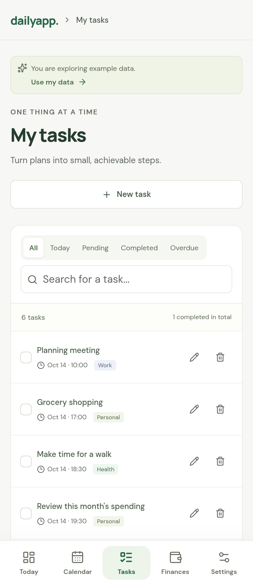 | 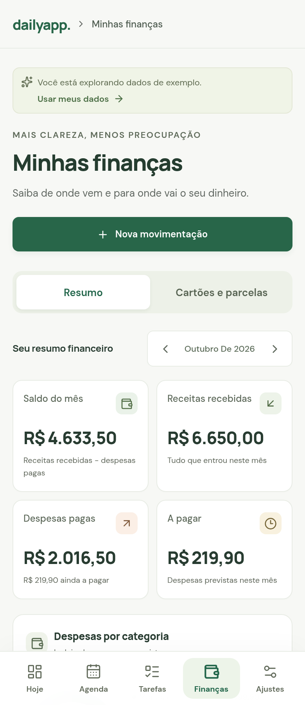 |

Mobile screenshots captured from the current app in Chromium at a 390 × 900 viewport, using **Explore example**. Expand a language below to see the same screens in that language. Run `npm run screenshots` to regenerate the fifteen language captures and three currency examples after installing the dependencies and the Playwright browser. To generate only one language, set `DAILYAPP_SCREENSHOT_LANGUAGES` to `en`, `pt-BR`, `es`, `fr`, or `de`.

<details>
<summary>Português</summary>

| Today | Tasks | Finances |
| --- | --- | --- |
| 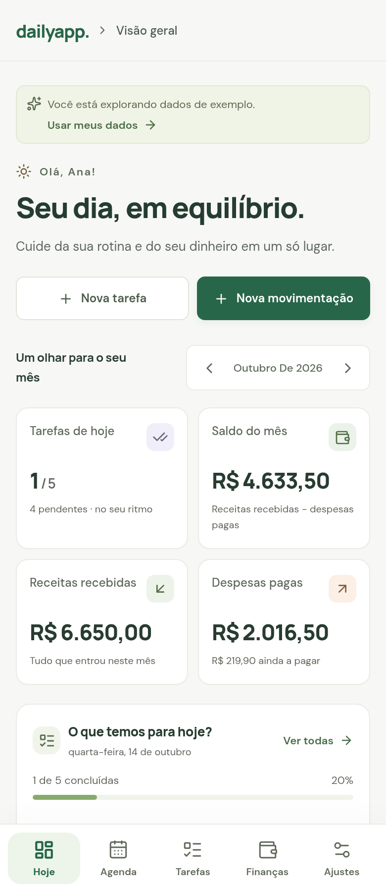 | 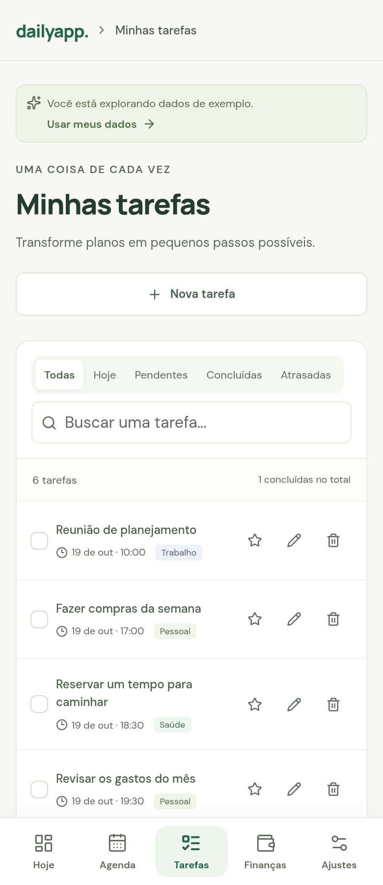 | 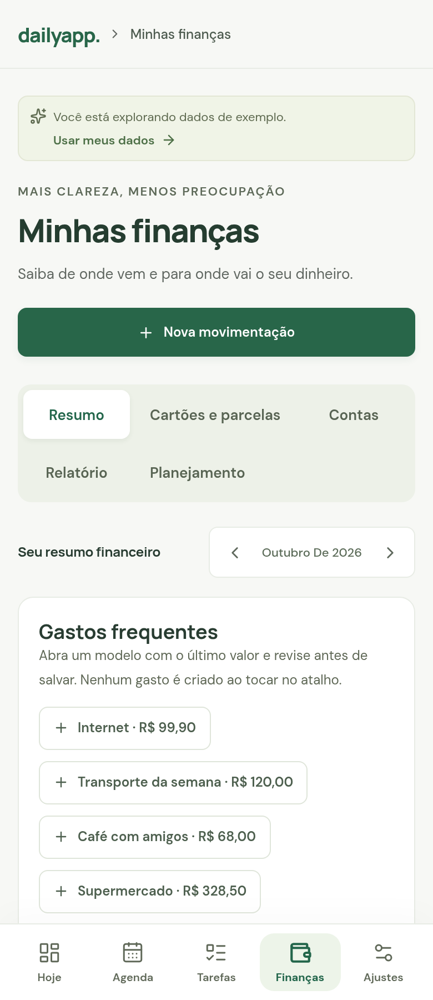 |

</details>

<details>
<summary>Español</summary>

| Today | Tasks | Finances |
| --- | --- | --- |
|  | 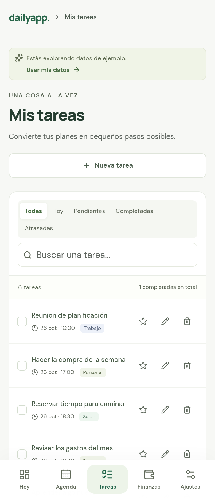 | 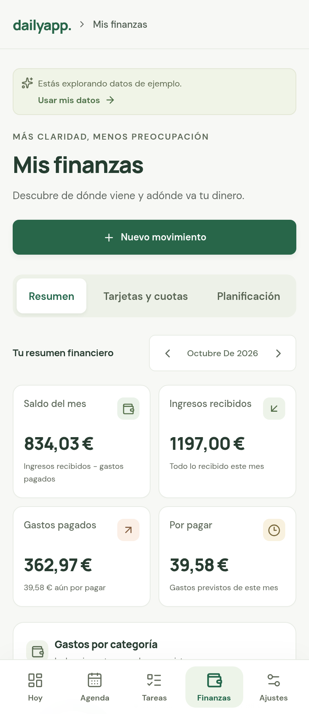 |

</details>

<details>
<summary>Français</summary>

| Today | Tasks | Finances |
| --- | --- | --- |
| 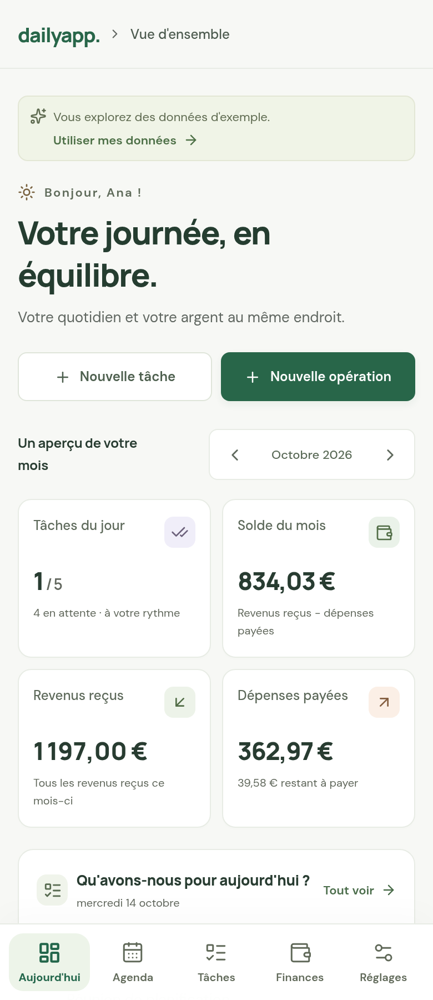 | 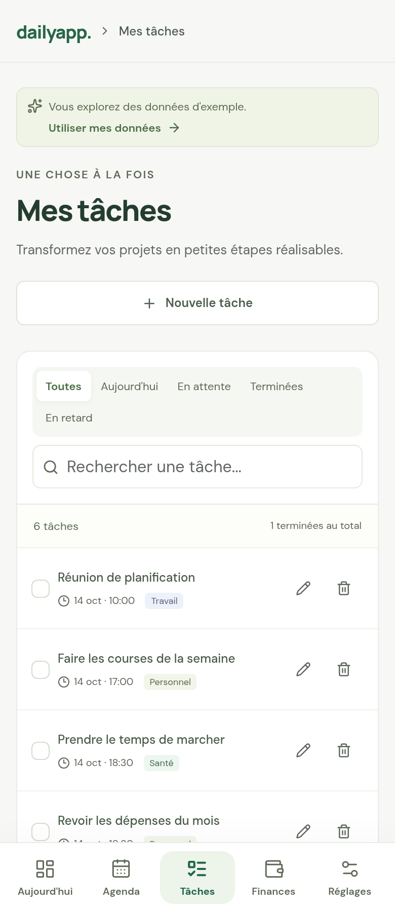 | 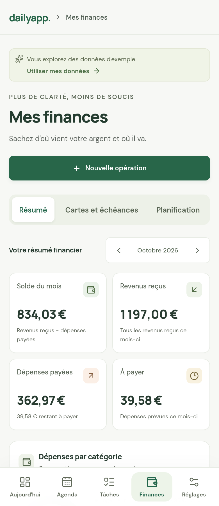 |

</details>

<details>
<summary>Deutsch</summary>

| Today | Tasks | Finances |
| --- | --- | --- |
| 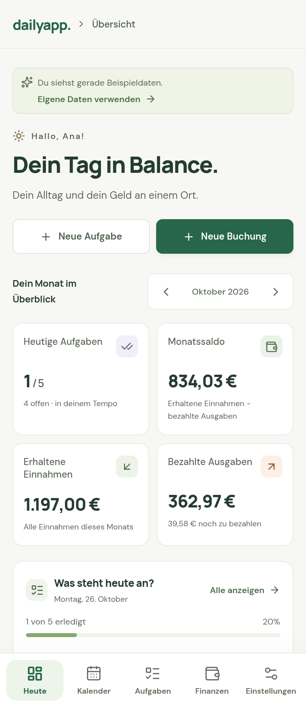 | 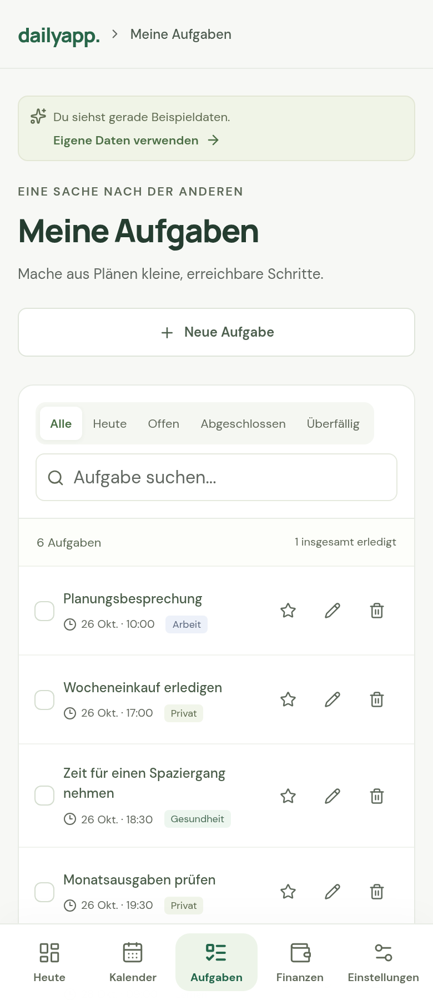 | 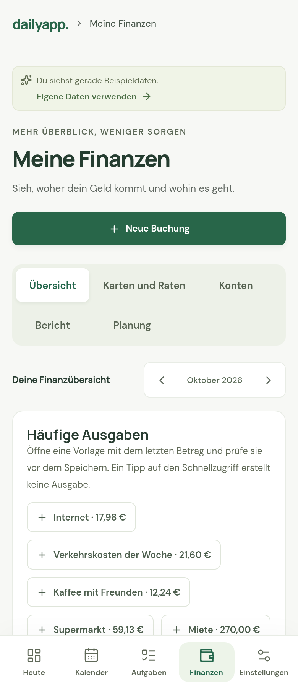 |

</details>

## Features

- English by default, with complete Portuguese, Spanish, French, and German translations; switch instantly in Settings.
- Real conversion between BRL, USD, EUR, GBP, CAD, and AUD, with online quotes, manual rates, and the last saved rate offline. Currency and language are independent.
- Bottom navigation with Today, Calendar, Tasks, Finances, and Settings.
- First-use setup with an optional name and budget, plus a quick guide in Settings.
- Create, edit, complete, and delete tasks with dates, times, categories, and priorities.
- Monthly calendar with tasks for the selected day.
- Today screen with pending bills, income, and installments, including overdue items and the next seven days.
- Income, expenses, confirmed or planned amounts, history, categories, and monthly budgets.
- Recurring tasks and transactions with daily, weekly, monthly, or yearly repetition; ending a routine preserves its history.
- Credit cards, estimated available limits, statement closing dates, payment due dates, and purchases split into up to 48 installments with exact cent allocation.
- Monthly card bills that update their installments when marked as paid, without duplicating expenses.
- Financial goals with target amounts, deadlines, progress, and suggested monthly savings.
- End-of-month and daily balance forecasts with a manually entered opening balance and negative-balance warnings.
- Local reminders for tasks, bills, and card payments, with notification permission; reminders update when records are completed, paid, or edited.
- Data stored on the device, without requiring an account or an internet connection.
- JSON backup export through Android/iPhone sharing and import through the file picker.
- Android's back button closes forms and returns to the home screen before minimizing the app.
- Layout adapted to screen safe areas, with app icons for both platforms.

The monthly balance includes income received and expenses paid during the month. Budgets include paid and planned expenses. Calculations use integer cents. Optional fictional data is available through **Explore example**.

## Languages

Open **Settings → App language** and choose:

| Language | Option in the app |
| --- | --- |
| English (default) | English |
| Portuguese (Brazil) | Português |
| Spanish | Español |
| French | Français |
| German | Deutsch |

No download or network connection is required: all translations are bundled with the app. The choice is saved on the device and included in backups. Restoring a backup with a language restores that choice; older backups keep your current preference. Number separators and date names follow the selected language, while the display currency is selected separately. System permission and file picker dialogs follow device settings.

## Currency conversion

Open **Settings → App currency**, choose **BRL, USD, EUR, GBP, CAD, or AUD**, and tap **Save currency**. BRL remains the default in every language. For another currency, the app uses its saved quote or fetches one if none is available. You can use English with reais or Portuguese with dollars.

**Refresh exchange rate** retrieves the latest available daily quote from [Currency API](https://github.com/fawazahmed0/exchange-api), served by jsDelivr without an API key. Quote requests contain no personal records. The source date is shown; rates older than seven days are marked. Tap **Save currency** to apply a refreshed quote. If the source is unavailable, the previous saved rate remains usable. **Enter a manual rate → Save manual rate** lets you enter the value of **1 BRL in the selected currency**, with up to eight decimal places. For example, 0.20 USD per BRL displays R$100.00 as $20.00. Manual rates are labeled and dated separately from online quotes.

The selected currency is used for transactions, totals, budgets, card limits and bills, goals, opening balances, forecasts, and chart labels. New and edited amount fields accept that currency and convert back to BRL when saved. Original records always remain in **integer BRL cents**; changing currency never rewrites their amounts. Saving an unchanged converted field preserves its original cents. Conversion and installment displays round to the nearest cent, so rounded displayed parts may differ by a cent from a converted total.

This is a current-rate estimate: it does not record historical purchase rates, execute currency exchanges, or include bank fees. Refreshing a quote changes displayed estimates, including past records. Preferences, rates, dates, and sources are included in backups. Old backups remain compatible and open in BRL. No initial quote is invented or required for BRL; without internet, a different currency needs a saved or manual rate. Core tasks and finances continue to work offline.

## What each feature does

The guide uses the default English interface. Change the language in **Settings → App language**. All app screens, buttons, categories, filters, dialogs, help, dates, number formatting, and local reminder text update to your selection. Choose the display currency separately in **Settings → App currency**; BRL is the default. Your own names, task titles, transaction descriptions, and notes keep their original content.

### Today

| Feature | Purpose and how to use it |
| --- | --- |
| Monthly overview | Shows income received, expenses paid, and the difference between them in the selected month. This **monthly balance** does not include money you had before the month started. Use the arrows to change the period. |
| Today's tasks | Lists today's tasks, times, and progress. Tap the circle to complete a task or undo completion; **View all** opens the Today filter in Tasks. |
| Earlier tasks | Highlights unfinished tasks from previous days and opens the Overdue filter. |
| Bills and income | Collects pending transactions from previous days, today, and the next seven days, including installments and recurring records. This period follows the current date, regardless of the month selected in the overview. Tap a description to edit; **Pay** or **Receive** confirms the existing record without creating another one. To undo this, open the transaction in Finances and change its status back to Planned. |
| Money in motion | Charts cumulative income received and expenses paid during the month. **View details** opens Finances. |
| Spending by category | Shows how paid and planned expenses are distributed across food, housing, transportation, and other categories. |
| Goals and monthly forecast | Opens **Finances → Planning** for the current month. |

### Calendar and Tasks

| Feature | Purpose and how to use it |
| --- | --- |
| Calendar | Browse months and tap a date to see its tasks. **Today** returns to the current day. The calendar lists tasks; bills and installments appear on Today and in Finances. |
| New task | Enter a title, date, optional time, category, priority, and notes. When creating a task from Calendar, the selected date is filled in automatically. |
| Edit and delete | Tap the task or pencil icon to edit. The trash icon asks for confirmation before deleting. |
| Complete | The circle marks a task as completed; tapping again makes it pending. Today's progress updates accordingly. |
| Search and filters | Search titles, categories, or notes. Use All, Today, Pending, Completed, and Overdue to find what you need. |
| Repeat task | Creates a daily, weekly, monthly, or yearly routine. Future tasks start as pending. In shorter months, the day is adjusted while preserving the original reference for later months. |
| Recurring routines | Shows active routines. **Stop repeating** removes only future pending occurrences; earlier records, today's records, and completed tasks remain. Editing changes only the selected occurrence. Deleting an occurrence does not recreate it when the app opens again. |

### Finances → Overview

| Feature | Purpose and how to use it |
| --- | --- |
| New transaction | Record income or an expense with a description, amount in the selected currency, date, category, and notes. Choose whether it has already been received/paid or is still planned. |
| Income, expenses, and balance | Confirmed income and expenses make up the month's net result. **To pay** adds up planned expenses for the period, including installments. |
| Paid, Received, or Planned status | Tap the status to confirm or undo a payment or receipt. The record is updated; no additional transaction is created. The labels are Paid, Received, and Planned. |
| History, search, and filters | Browse transactions for the selected month. Filter by income/expense and Confirmed/Planned; search descriptions, categories, or notes. |
| Monthly budget | Set a spending limit for the month. The progress bar includes paid **and planned** expenses, including installments. Each month has its own budget; the forecast's opening balance is a separate setting. |
| Expenses by category | Compares paid and planned spending across categories. |
| Repeat transaction | Schedules recurring income and bills daily, weekly, monthly, or yearly. Future occurrences start as planned and require manual confirmation. |
| Edit and delete | The pencil edits a transaction and the trash icon asks for confirmation. For installment purchases, deleting an installment removes **the entire purchase and all its installments, including paid ones**; the confirmation explains this. |

### Finances → Cards and installments

| Feature | Purpose and how to use it |
| --- | --- |
| New card | Enter a name, limit, statement closing day, and payment due day. The app does not ask for a card number, password, or security code. |
| Record purchase | Enter the **total** amount and between 1 and 48 installments. The app allocates cents without changing the total and creates each installment as a planned expense on its due date. Do not enter the same purchase again under New transaction. |
| Closing and due dates | Purchases on or after the closing day enter the next billing cycle. Days 29, 30, and 31 are adjusted in shorter months. Changing a card's dates affects only new purchases. |
| Monthly card bill | Shows the card's installments for the selected month and the amount still due. **Mark bill as paid** confirms those installments without creating another expense. |
| Available limit | Estimates the limit minus all unpaid installments, including future ones. It does not query the bank and does not represent a limit approved by the bank. |
| Archive and reactivate | Archiving prevents new purchases while preserving installments, bills, and earlier records. Reactivating allows new purchases. |

### Finances → Planning

| Feature | Purpose and how to use it |
| --- | --- |
| Monthly opening balance | Enter the money available **before the first transaction of that month**. Zero and negative values are allowed. Do not use a current balance that already includes recorded transactions. Enter each month separately; balances do not carry over automatically. |
| Balance forecast | Calculates **opening balance + income − expenses for the month**, both confirmed and planned. Each installment is included once, in its due month. Marking a payment changes its status while keeping the projected amount the same. The forecast appears only after an opening balance is entered. |
| Daily evolution | Shows the projected closing balance for each date with transactions and the lowest daily balance. A warning highlights negative estimates. The order of payments within the same day is not simulated. |
| Bills from earlier months | Appear as a warning and on Today; they are not deducted again in another month. If paid in the current month, update the transaction's date to that month. |
| New goal | Set a name, target amount, deadline, notes, and how much you have already saved. Use it for an emergency fund, trip, purchase, or another objective. |
| Update goal | Enter the **total already saved**, rather than just the latest deposit. The app shows the percentage, remaining amount, and a suggested monthly amount through the deadline, counting the current month. A goal becomes Completed when its target is reached; if the deadline passes first, it shows Deadline passed. |
| Archive, reactivate, and delete goals | Archiving hides a goal and preserves its data; **Show archived** lets you reactivate it. Deleting requires confirmation and removes the goal and its progress. |

Forecasts depend on the dates and amounts entered and do not connect to banks. Goals are tracked manually: they do not transfer money, reserve a balance, or create income/expenses automatically. Record actual spending or income in Finances.

### Reminders

Choose how far in advance to be notified when creating/editing a task, transaction, or card, and allow notifications on your phone. Tasks require a time; bills and card payments notify at **9 a.m. local time**. Completing, paying, changing, or deleting a record updates its future reminders. The operating system may delay notifications to save battery; delayed reminders that are still valid are preserved.

The app schedules up to **60 upcoming notifications** and refreshes them when opened or resumed. Routines prepare up to **90 days of tasks and 12 months of transactions**, extending that period when you return to the app. Tasks and payments are not confirmed automatically. The computer preview saves preferences but does not send native notifications.

### Settings and mobile features

| Feature | Purpose and how to use it |
| --- | --- |
| App language | Select English, Português, Español, Français, or Deutsch in Settings. The interface changes immediately and the choice is saved across restarts and included in backups. |
| App currency | Select a display currency separately from the language. Refresh and save an online quote, use a cached quote offline, or enter a manual rate. All financial screens and fields convert while stored BRL cents remain preserved. |
| Your name | Personalizes the greeting. Name and budget are optional during first-use setup. |
| Export backup | Creates a JSON file with tasks, transactions, cards, routines, goals, opening balances, budgets, reminder settings, the selected language, currency, and saved exchange rates with dates and sources. On a phone, choose where to save it through the share menu; on a computer, download the file. |
| Import backup | Select a DailyAPP JSON file and confirm restoration. This **replaces the current data**, rather than merging it. Earlier backups are still accepted; export your current data first if you want to preserve it. |
| Load/Explore example | Loads fictional data to explore the screens. If data already exists, asks for confirmation before replacing it. **Start with your own data** removes example tasks, transactions, and budget while preserving personal records you added. |
| How to use DailyAPP | Opens the in-app quick guide through **How to use DailyAPP**. |
| Phone reminders | Shows the number of scheduled notifications and lets you enable/refresh them. If permission was denied, allow notifications in your phone's settings. |
| Delete my data | After confirmation, removes all local records and financial settings. Only an exported backup can restore them. |
| Bottom navigation | Opens Today, Calendar, Tasks, Finances, and Settings. |
| Android back button | Closes forms, confirmations, and the guide; then returns to Today and, on another back press, minimizes the app. |
| Offline use | Tasks, finances, goals, forecasts, and local reminders work on the device. Each installation has its own data; use backups to transfer between devices. |

## Prepare the projects

Requires Node.js 22.12 or later and npm.

```bash
npm ci
npm run mobile:sync
```

This command builds the mobile interface in `dist/mobile/` and copies the files into `android/` and `ios/`. The mobile build opens the local workspace directly, without importing the account screen or embedding Supabase variables.

To develop the interface, run:

```bash
npm run dev -- --mode mobile
```

This server is a development tool; the installed app loads files included in its package. It does not use a remote website address.

## Android

With Android Studio, JDK 21, and Android SDK 36 installed:

```bash
npm run mobile:android
```

In Android Studio, select a phone/emulator and run the project. To generate the personal-use installer from the command line, with Python 3 also installed:

```bash
npm run mobile:personal
```

The installer is saved to `artifacts/DailyAPP-1.1-pessoal.apk`. It uses a Release build with application and WebView debugging disabled. It preserves the previous APK's development certificate to support updates to the personal installation, with `versionCode` 5. Keep that local key when building future updates. Play Store publication requires a dedicated distribution key. `npm run mobile:apk` remains available to generate a debug APK.

## iPhone

On a Mac with Xcode 26 or later:

```bash
npm run mobile:ios
```

In Xcode, select the **App** project, configure your team under **Signing & Capabilities**, and run it in the simulator or on a connected iPhone. The project uses Swift Package Manager and includes the privacy manifest required by the filesystem plugin. The app requires iOS 15.4 or later.

IPA 1.1 was built and published through [.github/workflows/personal-release.yml](.github/workflows/personal-release.yml), using Xcode 26.3 on the `macos-15` runner. Its bundled interface files were compared with the Android package, and download hashes were checked. The result is an IPA **without personal signing**. Signing and installation instructions are in the [mobile guide (Portuguese)](docs/CELULAR.md#iphone-sem-mac-pessoal); installation and operation on a real iPhone still need to be confirmed. The [ios-personal.yml](.github/workflows/ios-personal.yml) workflow also supports generating a build artifact manually, without creating a Release.

## Verification

```bash
npm run build:mobile
npm test
```

The 78 tests use Playwright and Chromium. They cover actual currency conversion, inverse amount inputs, quote failures, cached and manual rates, balance forecasts, goals, bills on Today, tasks, finances, local data, backups, storage failures, dates, navigation, first use, existing-data upgrades, all five languages, accessibility, and offline use of the mobile interface. Native plugin contracts are simulated: browser tests do not replace testing on a phone, especially for the keyboard, file picker, and sharing.

Test servers use ports 5174 (local workspace), 5175 (mocked accounts from the earlier implementation), and 5176 (mobile app interface). In the cloud environment, the available browser is `/usr/bin/chromium`; on other machines, run `npx playwright install chromium` once.

## Data and backups

Records are stored in the app WebView's private storage. Closing and reopening the app keeps them. The `dailyapp.v1` format is preserved: users with existing records enter the app directly. Uninstalling the app or clearing its data may remove those records. In **Settings**, export a backup to keep a copy or transfer records between devices; restoring requires confirmation.

Local storage is not an encrypted vault. The current mobile version does not connect to banks, require login, or synchronize devices automatically. The earlier account implementation is preserved in `src/cloud/` for a future stage if requested; it is not included in the mobile package.

## Project structure

```text
capacitor.config.ts   App name, identifier, and configuration
android/              Android project and Gradle Wrapper
ios/                  Xcode project and Swift dependencies
src/mobile-main.tsx   Installed app entry point
src/mobile/           Sharing, files, and back button
src/App.tsx           Tasks, calendar, finances, and settings
src/domain.ts         Types, validation, and calculations
src/i18n/             Five-language catalogs, locale formatting, and saved language preference
src/currency.ts       BRL-based conversion, quote validation, online rates, and inverse inputs
resources/            Logo for icons and splash screen generation
scripts/              Builds and helper tools
tests/                Interface and contract checks
```

In the cloud environment, use the existing checkout at `/workspace/DailyAPP`. Each task is already isolated; do not create worktrees unless requested. Dependencies and tools may remain in the snapshot, but development servers must be started again. Read the [mobile guide (Portuguese)](docs/CELULAR.md) for this environment's commands and limitations.
